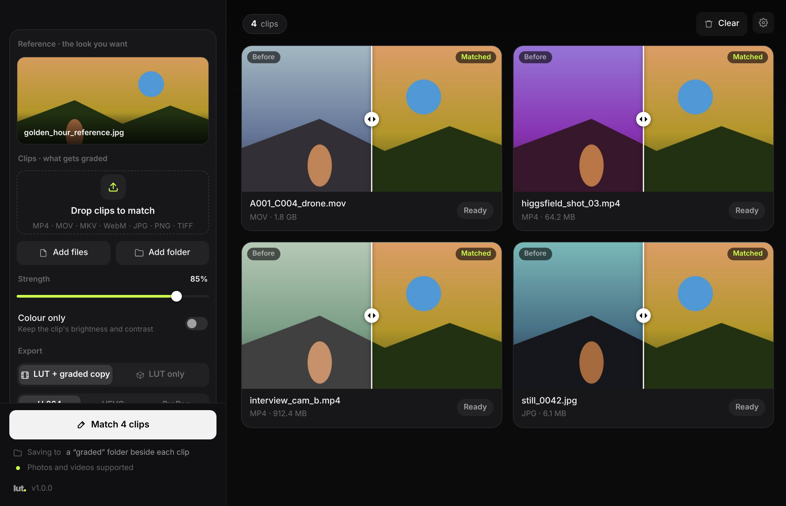

<p align="center">
  
</p>

<h1 align="center">lut</h1>

<p align="center">
  <b>Match the colour of one shot to another.</b><br>
  Drop a reference and your clip. Get a <code>.cube</code> LUT and a graded copy.<br>
  On your own computer, for macOS and Windows.
</p>

<p align="center">
  <a href="https://github.com/YuvrajxGarg/lut/releases/latest"></a>
  
  <a href="LICENSE"></a>
</p>

<p align="center">
  
</p>

## Why

An AI shot next to real footage, a B-cam that doesn't match the A-cam, a drone clip that came out blue. Matching them by hand means a colourist's eye and twenty minutes of wheels. Lut does the first pass for you, and since the result is a real LUT, you can keep refining it in your editor.

## Download

| Platform | Download | First launch |
|---|---|---|
| **macOS** 11+ · Apple silicon | [**Lut-mac.zip**](https://github.com/YuvrajxGarg/lut/releases/latest/download/Lut-mac.zip) | Unzip and move **Lut** to Applications. The app isn't notarized, so the first time: right-click → **Open**. On macOS 15 and later, go to **System Settings → Privacy & Security → Open Anyway** instead. |
| **Windows** 10 / 11 · 64-bit | [**Lut-windows.zip**](https://github.com/YuvrajxGarg/lut/releases/latest/download/Lut-windows.zip) | Unzip the **Lut** folder somewhere you own (Documents, Desktop) and run **Lut.exe**. If SmartScreen appears, click **More info → Run anyway**. |

Or install it from [PXL](https://github.com/YuvrajxGarg/pxl). Website: [lut.pxlvzn.in](https://lut.pxlvzn.in). ffmpeg comes bundled, so there's nothing else to install. Lut checks this repository for new releases and updates itself.

## How it works

1. **Drop a reference** on the left half of the window: a still or a clip with the look you want.
2. **Drop your clips** on the right half. Each one shows a before and after wipe straight away; move the pointer across it to compare.
3. **Tune** the strength, or switch on **Colour only** to keep each clip's own brightness and contrast.
4. **Match.** For every clip you get `clip.cube` and `clip_graded.mp4` (or `.jpg`, `.png`…) in a `graded` folder beside it, or in a folder you choose. Originals are never modified.

## What's in the match

Lut samples frames across the whole clip and the reference, then works in [OKLab](https://bottosson.github.io/posts/oklab/), a colour space built to track how people see colour:

- **Monge-Kantorovich colour transfer.** The smallest linear change that gives the clip the reference's average colour and spread: white balance, tint, saturation, and how colour shifts with brightness. It moves colours as little as it can, so skin stays skin.
- **A tone curve from histogram matching** on lightness, smoothed so gradients don't band. This carries over contrast, black level and highlight roll-off.
- **Baked into a 33-point 3D LUT** (`.cube`, Rec.709 in and out). It loads in DaVinci Resolve, Premiere Pro, Final Cut Pro, After Effects, CapCut and OBS.

The graded copy is that same LUT applied with ffmpeg's `lut3d` filter (tetrahedral interpolation), so the file you get and the LUT you load always agree. Black letterbox bars are left out of the measurement.

## Export options

| | |
|---|---|
| **LUT + graded copy** | H.264 (CRF 16) by default, HEVC for smaller files, or ProRes 422 HQ (`.mov`, 10-bit) for further grading. Audio is copied untouched. |
| **LUT only** | Just the `.cube`, for when you'll apply it in your editor. |

## Command line

```bash
Lut match look.jpg A001.mov B002.mov            # LUT + graded copy for each clip
Lut match look.mp4 ~/Footage/day2 --lut-only    # a whole folder, LUTs only
Lut match look.jpg drone.mp4 -s 0.7 --keep-luma --codec prores -o ~/Desktop/graded
Lut apply drone.cube more_drone/                # grade more clips with a LUT you already have
```

On macOS the binary lives at `Lut.app/Contents/MacOS/Lut`. From source, run `python Lut.py …`.

## Limits

- **A first pass, not a colourist.** Lut matches overall colour statistics. If the reference is a sunset and your clip is a forest at noon, it'll make the forest warm and golden, not turn it into a sunset. It works best when both shots have broadly similar content.
- **Rec.709 / sRGB footage.** Log and HDR (S-Log, V-Log, HLG, PQ) need converting to Rec.709 first, or the LUT will be built against the wrong curve.
- **Graded videos are re-encoded.** That's unavoidable when pixels change. Pick ProRes if you'll grade further.

## Build from source

You need Python 3.9+. On macOS, [uv](https://docs.astral.sh/uv/) is the easiest way to get it.

```bash
pip install -r requirements.txt
python Lut.py
```

| | |
|---|---|
| **macOS app** | `./build_mac.sh` builds `dist/Lut.app`. Add `--install` to copy it to `~/Applications`. |
| **Windows app** | `build_windows.bat` builds `dist\Lut\Lut.exe`. |
| **Tests** | `python -m unittest discover tests` |
| **UI preview** | Open `lutmatch/ui/index.html?demo&filled` in a browser. |
| **Icons** | `python assets/make_icon.py` |

### Layout

```
lutmatch/core.py      the engine: OKLab, MKL + tone curve, .cube read/write, frame sampling and grading via ffmpeg
lutmatch/cli.py       `Lut match` and `Lut apply`
lutmatch/webapp.py    the window: HTML/CSS UI in a native WebKit / WebView2 view (pywebview)
lutmatch/updater.py   GitHub Releases updater (check → download → verify → swap)
lutmatch/ui/          the interface
Lut.spec              PyInstaller recipe for both platforms
```

## Releasing

1. Bump `VERSION` and commit.
2. Tag and push:

   ```bash
   git tag v1.0.0 && git push origin v1.0.0
   ```

3. The **Release** workflow builds, tests and smoke-tests both apps, then attaches `Lut-mac.zip` and `Lut-windows.zip` (each with a `.sha256`) to the release. Installed copies pick it up on their next update check, and PXL installs from it.

## License

[MIT](LICENSE). Release builds bundle [FFmpeg](https://ffmpeg.org) via [imageio-ffmpeg](https://github.com/imageio/imageio-ffmpeg).
